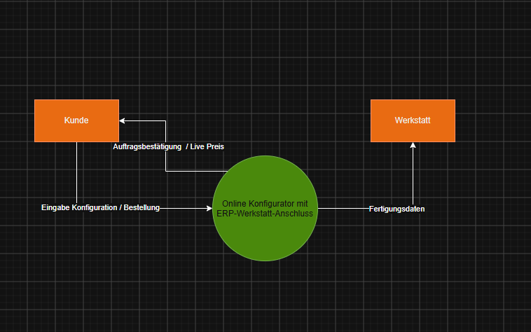
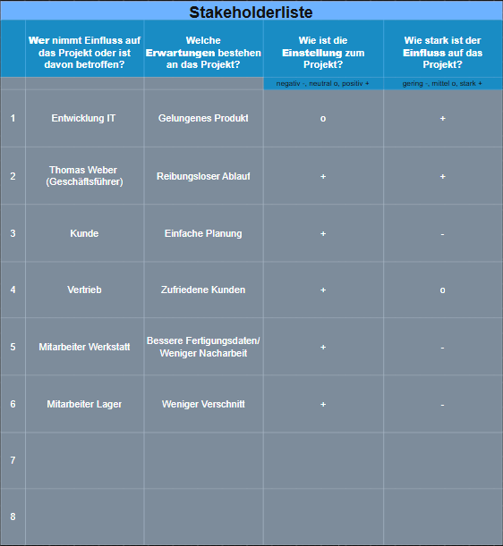
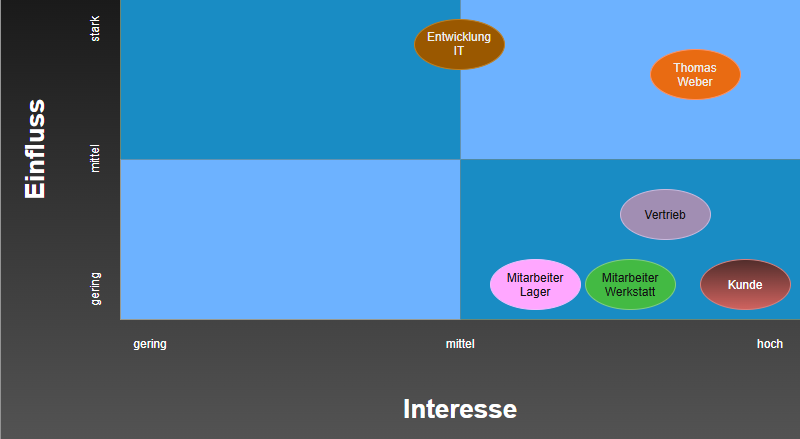

# business-analysis-portfolio
# Portfolio-Projekt: Digitaler Möbel-Konfigurator (HolzArt Manufaktur GmbH)
# Portfolio-Projekt: Business Analyse & Requirements Engineering (IREB)

**Projekt-Glossar:** Das vollständige Glossar mit allen Fachbegriffen findest du in der [GLOSSARY.md](./GLOSSARY.md).

Dieses Portfolio-Projekt entstand im Rahmen der Vorbereitung auf die IREB-Zertifizierung. Die Aufgabenstellung wird fortlaufend durch praktische Methoden des Requirements Engineerings gelöst, um eine vollständige Anforderungsspezifikation nach IREB-Standard zu erstellen.

---

## 1. Ausgangsszenario & Kundenauftrag

* **Kunde:** HolzArt Manufaktur GmbH (Mittelständischer Handwerksbetrieb für maßgefertigte Massivholzmöbel)
* **Ansprechpartner:** Thomas Weber (Geschäftsführer)

### Problemstellung
Die HolzArt Manufaktur wächst, jedoch stoßen die manuellen Prozesse in der Auftragsabwicklung an ihre Grenzen. Kundenanfragen und Bestellungen erfolgen derzeit über E-Mails, Anrufe oder Skizzen. Dies führt zu hohem Aufwand im Vertrieb, unvollständigen Werkstattzeichnungen, Nacharbeiten und teurem Verschnitt.

### Ziel des Projekts
Spezifikation und Entwicklung einer digitalen Lösung (**Online-Möbelkonfigurator mit integrierter ERP- und Werkstatt-Schnittstelle**). Kunden sollen Möbel online konfigurieren, bepreisen und bestellen können, während die Werkstatt automatisch aufbereite Fertigungsdaten erhält.

---

## 2. Systemkontext & Kontextdiagramm (IREB-Standard)

Zur eindeutigen Abgrenzung des zu entwickelnden Systems von seiner Umwelt (Systemgrenze) wurde das folgende Kontextdiagramm erstellt:

[Editable Draw.io Source File](./assets/Kontextdiagramm.drawio)

### Methodische Erläuterung nach IREB
* **Systemgrenze:** Der Kreis in der Mitte umfasst das Gesamtsystem (Online-Konfigurator inkl. ERP-Anbindung).
* **Externe Akteure / Nachbarsysteme:** 
  * **Kunde:** Gibt Konfigurationsdaten ein und erhält Live-Preise sowie Auftragsbestätigungen.
  * **Werkstatt:** Empfängt die automatisiert generierten Fertigungsdaten zur Produktion.
* **Datenflüsse:** Die Pfeile repräsentieren ausschließlich reinen Informations- und Datenfluss 

## 3. Stakeholder-Analyse & Matrix (IREB-Standard)

Um sicherzustellen, dass alle relevanten Anforderungen erfasst und Stakeholder angemessen eingebunden werden, wurde eine Stakeholder-Analyse durchgeführt.

### Stakeholderliste

# Stakeholder-Analyse

## 1. Zweck der Stakeholderliste 

> Die Stakeholderliste dient als vorgelagerte Bestandsaufnahme, um alle irrelevanten und relevanten Personen, Rollen und Schnittstellen systematisch zu erfassen. Sie stellt sicher, dass keine Anforderungen oder Akzeptanzkriterien übersehen werden.

---

## 2. Kriterien der Erfassung (Was bedeuten die Spalten?)

| Kriterium | Beschreibung |
| :--- | :--- |
| **Erwartungen** | Welche Ziele und Anforderungen verbindet die Rolle mit dem System? |
| **Einstellung (Haltung)** | Wie steht der Stakeholder dem Projekt gegenüber? *(Alle Beteiligten stehen dem System positiv bzw. neutral gegenüber, da es Abläufe vereinfacht)* |
| **Einfluss (Projektmacht)** | Wie stark kann der Stakeholder Entscheidungen steuern oder blockieren? |

---

## 3. Methodische Erkenntnisse aus der Tabelle

> [!IMPORTANT]  
> **Das Wichtigste auf einen Blick**

*  **Entscheidungsträger mit starkem Einfluss:**  
  * **Geschäftsführung (Thomas Weber)** und **IT-Entwicklung** besitzen direkte Entscheidungsgewalt über Richtlinien, Ressourcen und Architektur.

*  **Beteiligte mit operativem Einfluss:**  
  * Der **Vertrieb** hat mittleren Einfluss (`0`), da seine Schnittstellenanforderungen für die Kundenakzeptanz entscheidend sind.

*  **Endanwender & Betroffene (geringer direkter Einfluss):**  
  * **Werkstatt**, **Lager** und **Endkunden** sind direkt vom System betroffen und stellen Kernanforderungen (z. B. fehlerfreie Fertigungsdaten, einfache Bedienung), steuern die Projektentscheidungen jedoch nicht direkt.

## 4. Aufgrund dieser Liste wurde eine Stakeholder-Matrix angefertigt

### Stakeholder-Matrix (Einfluss vs. Interesse)

* **Eng einbinden (Manage Closely):** Geschäftsführung (Thomas Weber) & IT-Entwicklung – besitzen hohe Entscheidungsgewalt und hohes Projektinteresse.
* **Informiert halten / Beteiligen (Keep Informed):** Vertrieb, Werkstatt, Lager & Kunde – sind stark vom System betroffen, steuern das Projekt jedoch nicht direkt.
